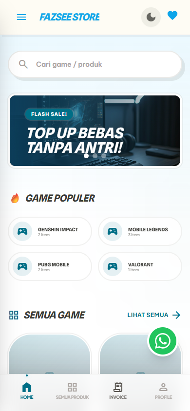
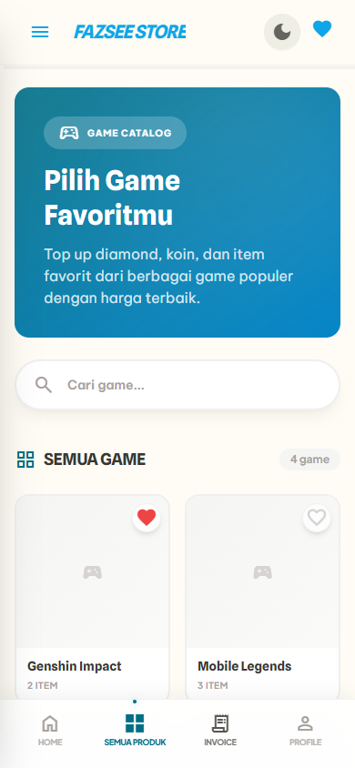
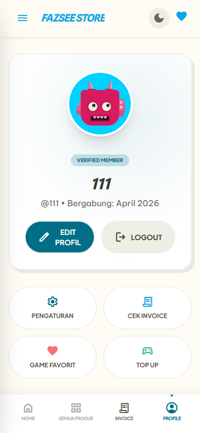

<div align="center">
  

  <p><strong>Platform top up game dan produk digital dengan pengalaman belanja yang praktis.</strong></p>
  <p>
    <a href="#fitur-utama">Fitur</a> ·
    <a href="#tampilan-aplikasi">Tampilan</a> ·
    <a href="#teknologi">Teknologi</a> ·
    <a href="#menjalankan-proyek">Instalasi</a> ·
    <a href="#kontak">Kontak</a>
  </p>
</div>

---

## Tentang Proyek

**Fazsee Store** adalah aplikasi *web* untuk pembelian produk digital dan *top up* game. Proyek ini menggunakan React pada sisi antarmuka serta NestJS untuk API, dengan PostgreSQL dan Prisma sebagai lapisan data. Antarmuka mendukung tema gelap/terang, pencarian katalog, daftar favorit, riwayat pesanan, pembayaran, serta area admin.

> **Status:** proyek aplikasi yang sedang dikembangkan. Ketersediaan layanan produksi dan konfigurasi pembayaran bergantung pada deployment serta pengaturan lingkungan.

## Fitur Utama

### 🛍️ Pengalaman Belanja
- Katalog kategori game dan produk digital.
- Pencarian kategori dan daftar produk populer.
- Alur pemesanan dengan informasi akun yang dapat disesuaikan.
- Daftar favorit (*wishlist*) dan tema gelap/terang.
- Halaman profil, pesanan, pembayaran, dan konfirmasi.

### 💳 Pembayaran dan Pesanan
- Dukungan konfigurasi pembayaran QRIS dan transfer manual melalui pengaturan toko.
- Pengunggahan bukti pembayaran.
- Status pesanan: menunggu, dibayar, diproses, selesai, atau gagal.
- Linimasa pesanan dan percakapan terkait pesanan.

### 🧑‍💻 Dashboard Admin
- Ringkasan analitik penjualan.
- Pengelolaan kategori, produk, dan pesanan.
- Pengaturan toko, termasuk informasi pembayaran dan kontak WhatsApp.
- Notifikasi WhatsApp yang membantu proses tindak lanjut pesanan.

### ⚙️ Keamanan dan Performa
- Autentikasi menggunakan JWT dan pembatasan akses berdasarkan peran.
- Validasi permintaan melalui ekosistem NestJS.
- *Caching* data di sisi antarmuka menggunakan SWR.
- Pemisahan pemuatan halaman melalui *lazy loading*.
- Dukungan *Progressive Web App* (PWA) melalui `vite-plugin-pwa`.
- Header keamanan dan kompresi pada backend.

## Tampilan Aplikasi

<div align="center">
  <table>
    <tr><td align="center"><strong>Beranda</strong></td><td align="center"><strong>Katalog</strong></td></tr>
    <tr><td></td><td></td></tr>
    <tr><td align="center"><strong>Riwayat Transaksi</strong></td><td align="center"><strong>Profil Pengguna</strong></td></tr>
    <tr><td></td><td></td></tr>
  </table>
</div>

## Teknologi

| Bagian | Teknologi |
|---|---|
| Frontend | React 19, Vite, Tailwind CSS, React Router, SWR |
| Backend API | NestJS 11, TypeScript |
| Database | PostgreSQL |
| ORM | Prisma |
| Autentikasi | Passport.js, JWT, bcrypt |
| Penyimpanan gambar | Cloudinary dan Multer |
| PWA | `vite-plugin-pwa`, Web App Manifest, Service Worker |
| Deployment | Frontend dapat dipasang di layanan statis; backend memerlukan layanan Node.js dan database PostgreSQL |

## Struktur Proyek

```text
Fazsee-Store/
├── frontend/
│   ├── public/                 # Aset statis dan ikon aplikasi
│   ├── src/
│   │   ├── components/         # Komponen antarmuka
│   │   ├── layouts/            # Navigasi dan kerangka halaman
│   │   ├── pages/              # Halaman pengguna dan admin
│   │   └── services/            # Integrasi API
│   ├── .env.example
│   └── package.json
├── backend/
│   ├── src/                    # Modul API NestJS
│   ├── prisma/                 # Skema database Prisma
│   ├── .env.example
│   └── package.json
├── docs/                       # Tangkapan layar dan banner README
└── README.md
```

## Menjalankan Proyek

### Prasyarat

- Node.js versi yang didukung oleh dependensi proyek.
- npm.
- PostgreSQL atau database PostgreSQL yang tersedia melalui `DATABASE_URL`.
- Kredensial Cloudinary bila fitur unggah gambar digunakan.

### 1. Clone repositori

```bash
git clone https://github.com/Dzakiudin/Fazsee-Store.git
cd Fazsee-Store
```

### 2. Konfigurasi backend

```bash
cd backend
npm install
```

Salin `.env.example` menjadi `.env`, kemudian sesuaikan nilai `DATABASE_URL`, `JWT_SECRET`, dan kredensial Cloudinary sesuai lingkungan lokal. Jangan mengunggah berkas `.env` atau kredensial rahasia ke repositori.

Setelah database tersedia dan `DATABASE_URL` sudah benar, jalankan:

```bash
npx prisma db push
npx prisma generate
npm run start:dev
```

Backend berjalan pada `http://localhost:3000` sesuai konfigurasi bawaan.

### 3. Konfigurasi frontend

Buka terminal baru dari direktori utama proyek:

```bash
cd frontend
npm install
```

Salin `frontend/.env.example` menjadi `frontend/.env`, lalu pastikan URL API sesuai alamat backend, misalnya:

```dotenv
VITE_API_URL=http://localhost:3000/api
```

Jalankan aplikasi frontend:

```bash
npm run dev
```

Vite biasanya menampilkan alamat lokal, umumnya `http://localhost:5173`.

### Perintah Pengembangan

| Direktori | Perintah | Kegunaan |
|---|---|---|
| `frontend` | `npm run dev` | Menjalankan server pengembangan |
| `frontend` | `npm run build` | Membuat hasil build produksi |
| `frontend` | `npm run lint` | Memeriksa kode frontend |
| `backend` | `npm run start:dev` | Menjalankan backend dalam mode pengembangan |
| `backend` | `npm run build` | Membuat build backend |
| `backend` | `npm test` | Menjalankan pengujian backend |

## Konfigurasi Lingkungan

**Frontend (`frontend/.env`)**

| Variabel | Keterangan |
|---|---|
| `VITE_API_URL` | URL dasar API backend, termasuk prefiks `/api` bila digunakan |

**Backend (`backend/.env`)**

| Variabel | Keterangan |
|---|---|
| `DATABASE_URL` | URL koneksi PostgreSQL |
| `JWT_SECRET` | Kunci rahasia untuk penandatanganan token JWT; gunakan nilai acak yang kuat |
| `JWT_EXPIRATION` | Masa berlaku token, misalnya `24h` |
| `CLOUDINARY_CLOUD_NAME` | Nama akun Cloudinary |
| `CLOUDINARY_API_KEY` | Kunci API Cloudinary |
| `CLOUDINARY_API_SECRET` | Rahasia API Cloudinary |
| `PORT` | Port server backend; konfigurasi contoh menggunakan `3000` |

## API

Frontend menggunakan API dengan prefiks yang ditentukan dalam `VITE_API_URL`. Area API mencakup autentikasi, kategori, produk, pesanan, pembayaran, pesan pesanan, pengaturan toko, dan endpoint admin. Detail endpoint dapat berubah mengikuti implementasi backend; periksa modul di `backend/src/` untuk kontrak API yang terbaru.

## Deployment

Deployment memerlukan konfigurasi frontend dan backend secara terpisah:

1. Deploy frontend dan atur `VITE_API_URL` ke URL backend produksi.
2. Deploy backend pada lingkungan yang mendukung Node.js.
3. Sediakan PostgreSQL dan isi `DATABASE_URL` dengan koneksi produksi.
4. Atur rahasia autentikasi serta kredensial layanan gambar sebagai *environment variables*.
5. Pastikan konfigurasi CORS, HTTPS, domain API, serta penyimpanan unggahan sesuai lingkungan produksi.

Pastikan pengujian integrasi, alur pembayaran, dan kontrol akses selesai sebelum membuka aplikasi untuk pengguna umum.

## Kontribusi

Perubahan dan perbaikan dapat diajukan melalui *issue* atau *pull request*. Sertakan konteks perubahan, langkah reproduksi untuk bug, dan tangkapan layar untuk perubahan antarmuka bila relevan.

## Kontak

Untuk pertanyaan terkait proyek, kunjungi profil pengembang atau repositori:

- GitHub: [@Dzakiudin](https://github.com/Dzakiudin)
- Repository: [Dzakiudin/Fazsee-Store](https://github.com/Dzakiudin/Fazsee-Store)

---

<div align="center">
  <sub>© 2026 Fazsee Store · Dikembangkan oleh Ahmad Dzakiudin</sub>
</div>
